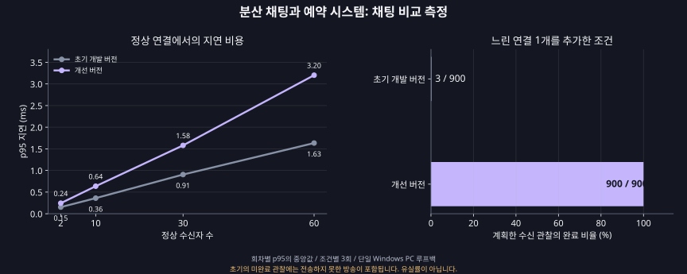
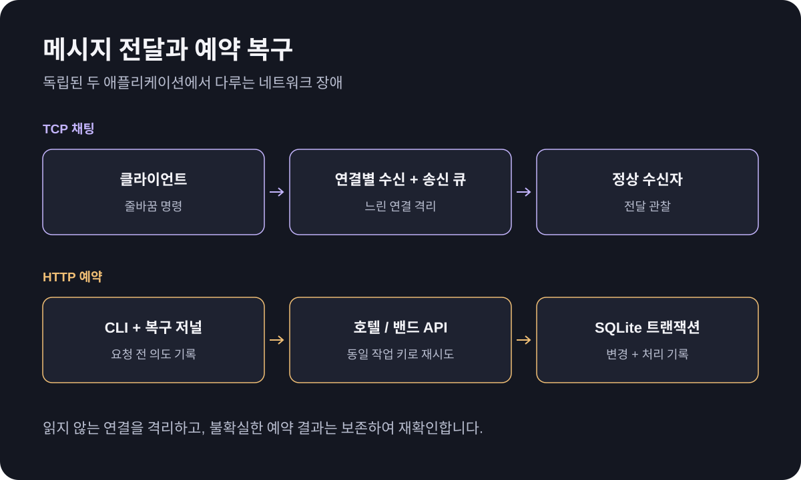

# 분산 채팅과 예약 시스템 (Distributed Chat and Reservation Systems)

[English](README.md) | [한국어](README.ko.md)

**Talk**는 여러 사용자의 TCP 메시지를 처리하고, **Hotel Wedding Planner**는 HTTP와 SQLite로 호텔 예약과 밴드 예약을 조율합니다. 두 애플리케이션은 하나의 저장소에서 서로 다른 네트워크 장애와 일관성 문제를 다룹니다. 세션이나 데이터베이스를 공유하는 하나의 서비스는 아닙니다.

최초 개발 기간은 **2024년 10월부터 12월**입니다. 안정성 보강과 재현성 개선은 **2026년 10월**의 후속 작업으로 구분했습니다. 초기 소스는 `1504ab3` 커밋을 포함한 Git 이력에 보존했습니다.

## 결과와 검증 자료

실제 TCP와 HTTP, 동시 예약, 응답 유실, 보상 취소, 프로세스 종료와 재시작을 포함한 **85개 검사를 4개 환경에서 모두 통과**했습니다. 총 340회 실행에서 실패와 오류, 생략은 0건이며, 초기 5개 검사도 유지했습니다.

느린 연결 1개와 정상 수신자 3개를 둔 같은 실험을 각 버전에서 3회 수행했습니다. 계획한 수신은 매회 900건이며 **초기 3건에서 개선 후 900건**으로 늘었습니다. 초기에는 300회 방송 중 48회만 시도하고 47회를 소켓에 전송했으므로 미완료 관찰을 메시지 유실률로 해석할 수 없습니다. 정상 60개 연결의 회차별 p95 중앙값은 **1.6338ms에서 3.2020ms**로 증가했습니다. 자원 사용 수치는 서버와 측정 클라이언트를 함께 포함합니다.

검증 환경은 **Windows Python 3.10.22 / 3.12.7, WSL Ubuntu Python 3.10.22 / 3.12.3**입니다. 각각 분리한 가상환경에서 잠금 파일로 의존성을 설치했습니다. Linux는 별도 소스 복사본을 사용했으며, 4개 환경의 소스 해시가 일치합니다. WSL은 같은 물리 컴퓨터를 사용합니다. GitHub Actions 성공을 주장하는 결과는 아닙니다.

측정 범위는 로컬 루프백 통신과 통제된 장애 조건입니다. 인터넷 지연이나 운영 환경의 최대 처리 용량을 의미하지 않습니다. [검증 요약](docs/reports/verification-summary.json), [초기 측정](docs/reports/initial-benchmark.json), [개선 후 측정](docs/reports/final-benchmark.json), [비교 결과](docs/reports/comparison.json)에서 조건과 원자료를 확인할 수 있습니다. GitHub Actions 설정의 존재와 실제 실행 성공은 구분하며, 실행 기록 없이 CI 성공을 주장하지 않습니다.





## 보존한 기능과 개선 내용

| 구성 | 유지한 초기 기능 | 보강한 부분 |
| --- | --- | --- |
| Talk | 등록, 전체 전송, 개인 전송, 사용자 목록, 종료, 줄바꿈 프로토콜, 연결별 수신 스레드 | 입력과 연결 수 제한, 등록 대기시간 제한, 제한된 송신 큐, 느린 수신자 격리, 종료 처리 |
| Hotel API | 예약 URL과 응답 형식, 데모 사용자, 서비스별 최대 2개 예약 | 예약 변경과 처리 기록의 원자적 저장, 멱등성 키, 처리 결과 조회, 현재 예약 세대 확인, 조건부 취소 |
| 예약 CLI | 수동 예약과 취소, 가용 슬롯 조회, 가장 이른 공통 슬롯 예약, 사용자가 선택하는 정리 메뉴 | 파일 기반 복구 저널, 프로세스 잠금, 미확정 결과 재확인, 현재 예약 쌍 확인, 해당 작업이 생성한 예약만 보상 취소 |

## 설치

Python **3.10 이상**이 필요합니다. Talk는 표준 라이브러리만 사용하며 Hotel은 Requests를 추가로 사용합니다. Docker나 외부 호텔 및 밴드 서비스는 필요하지 않습니다.

Windows PowerShell:

```powershell
python -m venv .venv
.\.venv\Scripts\python.exe -m pip install -r requirements-lock.txt
```

macOS 또는 Linux:

```bash
python3 -m venv .venv
.venv/bin/python -m pip install -r requirements-lock.txt
```

`requirements-lock.txt`에는 검증에 사용한 런타임 패키지 5개의 정확한 버전이 기록되어 있습니다. 지원 범위 안에서 의존성을 설치하는 `requirements.txt`도 유지했습니다. Ruff를 포함한 개발 도구의 검증 버전은 `requirements-dev-lock.txt`로 설치할 수 있습니다. 아래 명령의 `python`은 가상환경을 활성화한 뒤 사용하거나 가상환경 인터프리터 경로로 바꿔 실행합니다.

## Talk 실행

터미널 하나에서 서버를 실행하고 다른 터미널 두 개에서 클라이언트를 실행합니다.

```bash
python Talk/myserver.py
python Talk/myclient.py
python Talk/myclient.py
```

기본 주소는 `127.0.0.1:8090`입니다. 서로 다른 이름으로 등록한 뒤 다음 명령을 입력합니다.

| 입력 예시 | 동작 |
| --- | --- |
| `send_all Hello everyone` | 자신을 포함한 등록 사용자 전체에 전송 |
| `send_to Bob Hello Bob` | 접속 중인 Bob에게 개인 전송 |
| `user_list` | 등록 사용자 목록 확인 |
| `quit` | `Client exiting` 응답을 요청하고 연결 종료 |

직접 소켓을 사용하는 클라이언트는 `register <이름>`으로 등록합니다. UTF-8 텍스트와 줄바꿈으로 메시지 경계를 구분합니다. 정상 입력에 대한 초기 명령과 응답은 유지했습니다. 과도한 크기나 잘못된 인코딩은 제한 없이 받아들이는 대신 오류를 알리고 연결을 정리합니다.

| 서버 설정 | 기본값 |
| --- | ---: |
| 허용 연결 수 | 128개 |
| 입력 한 줄의 최대 크기, 줄바꿈 제외 | 8,192바이트 |
| 사용자명의 최대 크기 | UTF-8 기준 64바이트 |
| 연결 후 등록 대기시간 | 30초 |
| 연결별 송신 큐 | 128개 프레임 |
| 프레임별 송신 제한시간 | 2초 |

연결별 수신 스레드는 유지하고 송신 스레드를 추가했습니다. 수신을 멈춘 사용자 때문에 다른 사용자의 전송이 함께 지연되는 문제를 줄이기 위한 선택입니다. 큐가 가득 차거나 송신 제한시간을 넘기면 해당 연결을 종료합니다. `messages_enqueued`는 큐에 넣은 건수이고 `messages_sent`는 운영체제에 전체 프레임을 쓴 건수입니다. 수신자가 실제로 읽었다는 확인이나 영속적인 메시지 전달을 보장하지 않습니다. 대화 이력도 저장하지 않습니다.

설정 변경 예시:

```bash
python Talk/myserver.py 127.0.0.1 9000 --max-clients 64 --registration-timeout 30 --outbound-queue-size 64 --send-timeout 2
python Talk/myclient.py 127.0.0.1 9000
```

코드에서 사용하는 팩터리는 `create_server(host, port, **options)`입니다. `server.diagnostics()`는 대화 내용을 포함하지 않는 진단 카운터를 반환합니다.

## Hotel Wedding Planner 실행

첫 번째 터미널에서 API를 실행합니다.

```bash
python Hotel/local_api.py
```

두 번째 터미널에서 예약 CLI를 실행합니다.

```bash
python Hotel/booking.py
```

기본 API 주소는 `127.0.0.1:8081`이며 호텔과 밴드에 각각 1번부터 100번까지 슬롯이 있습니다. 예약 DB는 `Hotel/data/reservations.db`입니다. 메뉴 6은 가장 이른 공통 슬롯을 예약하고, 메뉴 3과 4는 수동 예약과 취소를 수행합니다. **불필요한 예약을 정리하는 동작은 사용자가 메뉴 7을 선택했을 때만 실행합니다.** 자동 매칭이 별개의 수동 예약을 임의로 정리하지 않습니다.

`Hotel/api.ini`의 사용자는 로컬 데모용입니다. `HOTEL_API_KEY`와 `BAND_API_KEY` 환경변수로 클라이언트의 사용자를 바꿀 수 있습니다. 인터넷 공개 서비스용 인증 체계는 아닙니다.

대화형 CLI는 기본적으로 `Hotel/data/booking-journal.db`에 복구 저널을 저장합니다. `BOOKING_JOURNAL_PATH`로 경로를 바꿀 수 있으며 상대 경로는 `Hotel`을 기준으로 해석합니다. 같은 API DB와 저널, 서비스 주소와 사용자로 다시 실행하면 끝나지 않은 자동 예약 작업을 확인합니다. 파일 저널의 프로세스 잠금은 같은 저널을 두 CLI가 동시에 사용하는 것을 막습니다. 결과가 불명확한 작업은 보존하며 해당 사용자 범위의 새 자동 예약을 보류합니다.

`reserve_best_match(clients)`를 직접 호출하면 **메모리 저널**을 사용하므로 호출이 끝난 뒤 재시작 복구가 되지 않습니다. 라이브러리에서 재시작 복구가 필요하면 `RecoveryJournal(path)`를 명시적으로 전달하고 같은 파일로 `recover_pending`을 호출해야 합니다. 수동 메뉴의 단일 요청은 자동 예약의 복구 워크플로와 구분됩니다.

## HTTP 호환성과 복구 계약

각 요청에는 해당 서비스의 데모 Bearer 인증정보가 필요합니다. 초기 예약 경로는 유지했습니다.

| 메서드 | 경로, `service`는 `hotel` 또는 `band` | 용도 |
| --- | --- | --- |
| GET | `/{service}/api/reservation/available` | 가용 슬롯 조회 |
| GET | `/{service}/api/reservation` | 현재 사용자의 예약 조회 |
| POST | `/{service}/api/reservation/{id}` | 예약 생성 |
| DELETE | `/{service}/api/reservation/{id}` | 보유 예약 취소 |
| GET | `/{service}/api/operation/{operation_id}` | 사용자별 요청 처리 결과와 현재 예약 세대 조회 |

Python 클라이언트는 하나의 논리적 변경 요청에 `Idempotency-Key`를 부여하고 재시도에서도 같은 키를 사용합니다. 서버는 예약 변경과 처리 결과를 하나의 SQLite 트랜잭션으로 저장합니다. 같은 요청을 재전송하면 저장된 결과를 반환하고, 같은 키로 메서드나 슬롯 또는 예상 예약 세대를 바꾸면 충돌로 처리합니다.

보상 취소에는 `Expected-Reservation-Operation-Id`를 전달합니다. 같은 슬롯이 취소된 뒤 다시 예약되었더라도 이전 작업의 복구 과정이 새 예약을 삭제하지 않도록 하는 조건입니다. 과거 예약 성공 기록만으로 현재 예약을 확정하지 않으며, 복구 완료 전 호텔과 밴드의 현재 예약 세대를 각각 확인합니다.

처리 기록은 자동으로 삭제하지 않습니다. 두 서비스의 예약과 조회는 하나의 분산 원자적 트랜잭션이 아닙니다. 복구가 미확정 상태로 남을 수 있고, 확인이 끝난 뒤 다른 사용자가 예약을 바꾸는 상황까지 막지는 못합니다.

## 검증과 측정 재현

```bash
python -m pip install -r requirements-dev-lock.txt
python -B scripts/verify.py --output target/verification.json
python -m ruff check Hotel Talk tests scripts
python -m ruff format --check Hotel Talk tests scripts
python -B scripts/benchmark.py --project . --scenario all --trials 3 --label current-source --output target/benchmark.json
```

테스트는 임시 포트와 임시 DB를 사용합니다. 서버를 미리 실행하거나 외부 인증정보, GPU와 클라우드 계정을 준비할 필요가 없습니다. 초기 버전과 비교하려면 `1504ab3` 커밋을 별도 디렉터리에 내보내고 현재 벤치마크 스크립트의 `--project`로 그 경로를 전달합니다. 양쪽 모두 같은 스크립트로 측정해야 합니다.

정상 수신 조건은 사용자 2명, 10명, 30명, 60명으로 나누고 회차별 예열 5회와 측정 20회를 사용합니다. 느린 수신자 조건은 수신을 멈춘 연결 하나에 작은 소켓 버퍼를 적용합니다. 지연 수치와 함께 누락과 중복 수를 확인해야 합니다. 일부 메시지만 도착한 결과를 낮은 지연만으로 성공이라고 평가하지 않습니다.

`ReservationApi`의 `max_elapsed`는 다음 재시도와 요청에 배분할 남은 시간을 제한하는 예산입니다. 개별 요청이나 전체 자동 예약이 반드시 그 시간 안에 종료된다는 **절대 실행시간 보장은 아닙니다.**

## 상세 문서와 한계

- [설계와 장애 처리](docs/ARCHITECTURE.ko.md) / [English](docs/ARCHITECTURE.md)
- [포트폴리오 범위와 근거](docs/PORTFOLIO.ko.md) / [English](docs/PORTFOLIO.md)

런타임 DB에는 예약 소유자와 처리 기록이 들어 있습니다. DB와 복구 저널, 잠금 파일, 대화 기록, 인증정보, 캐시와 개인 유지보수 메모는 공개 압축 파일에 포함하지 않습니다. 저널에는 평문 인증정보나 전체 예외 문구 대신 해시로 구분한 사용자 범위, 작업 상태와 예외 종류를 기록합니다. 이 프로젝트는 실패를 다루는 로컬 네트워크 시스템이며, 인터넷 공개용 채팅이나 예약 서비스를 완성했다는 의미는 아닙니다.
