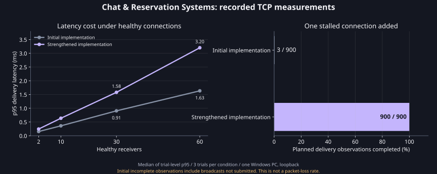

# Distributed Chat and Reservation Systems

[English](README.md) | [한국어](README.ko.md)

Two Python applications explore different network failures: **Talk** provides concurrent TCP messaging, while **Hotel Wedding Planner** coordinates hotel and band reservations through HTTP and SQLite. They share a repository, not an application session or data store.

Original development: **September to December 2024**. Reliability improvements and reproducibility work: **October 2026**, recorded separately from the original development period. The initial source remains in Git history, including commit `1504ab3`.

## What a user can do

In **Talk**, a user types a message in a terminal and another connected user receives it. **TCP** carries an ordered stream of bytes, so the application uses a newline to mark where each command ends. The main reliability question is whether a user who stops reading can delay everyone else.

In **Hotel Wedding Planner**, a user asks for the earliest bookable time slot available for both a hotel and a band. The planner sends **HTTP** requests to the local API and displays the reservation outcome; **SQLite** stores bookings and the information needed to recover an interrupted attempt. Hotel and Band are separate logical resources served by one local process. A timeout can mean that only the response was lost, so the planner must establish what actually happened before trying again or cancelling its own booking.

## Results and evidence

Read the test counts as checks of specified behaviors, and the delivery counts as observations of messages arriving at healthy clients. One broadcast sent to several receivers creates several expected delivery observations. **Loopback** means the clients and server communicate on the same computer. **p95 latency** describes the slower end of the measured delays: about 95% are at or below that value. The reported median trial-level p95 takes the middle of the repeated trials' p95 values; it is not the average delay or a worst-case guarantee.

**89 tests passed on Windows Python 3.10.21 and 3.12.7** after repairing rejection-response shutdown and transient receipt confirmation. All 178 executions passed with no failures, errors or skips, and both runs record the same current source hashes. The initial five tests remain. See the [CI repair verification](docs/reports/ci-repair-verification.json) and its two complete local run records.

The retained four-environment verification records **85 tests per environment and 340 passing executions** for an earlier source snapshot. Those reports and the following benchmark results remain historical evidence; they were not overwritten or rerun for the repair.

With one stalled connection and three healthy receivers, each version completed three identical trials: **3 of 900 planned delivery observations initially, versus 900 of 900 after strengthening in every trial**. The initial writer attempted only 48 of 300 broadcasts and submitted 47, so incomplete observations are not a message-loss rate. Under 60 healthy connections the median trial-level p95 rose from **1.6338ms to 3.2020ms**. Resource measurements include the server and client harness together.

The earlier four-environment record used **Windows Python 3.10.22 / 3.12.7 and WSL Ubuntu Python 3.10.22 / 3.12.3**, with separate virtual environments installed from the dependency lock. Linux used a separate source copy; normalized source hashes match within those four runs. WSL shares the same physical host. The latest local records cover the two Windows versions listed above, while performance benchmarks retain their original source snapshot.

The measurements use local loopback connections and controlled faults. They do not estimate internet latency or production capacity. See the [earlier verification summary](docs/reports/verification-summary.json), [initial benchmark](docs/reports/initial-benchmark.json), [final benchmark](docs/reports/final-benchmark.json), and [comparison](docs/reports/comparison.json). For automated cross-platform runs, see [GitHub Actions](https://github.com/Dongmyung378/Distributed-System/actions/workflows/ci.yml).




## What was strengthened

A **bounded queue** is a waiting list with a maximum size. Each Talk recipient has its own list, so a recipient that stops reading does not keep everyone else waiting; when that list fills, the affected connection is closed. This is the project's response to **backpressure**, where messages arrive faster than a receiver can consume them.

For reservations, **idempotency** means a repeated request with the same operation key reuses its recorded outcome instead of applying the change twice. A **receipt** records the server's outcome, while a **journal** records the planner's intended steps for restart recovery. **Compensation** cancels a booking made by an incomplete workflow. Its **generation guard** identifies the particular booking creation, protecting a later replacement reservation in the same slot.

| Area | Initial behavior retained | Reliability improvement |
| --- | --- | --- |
| Talk | Registration, broadcast, direct messages, user listing, quit, newline protocol, one receiving thread per connection | Bounded input, bounded connections, registration deadline, bounded outgoing queues, slow-peer isolation, orderly shutdown |
| Hotel API | Original reservation URLs, response bodies, demo identities, two-reservation limit | Atomic mutation receipts, replay-safe request keys, receipt lookup, current reservation generation, guarded cancellation |
| Planner CLI | Manual reserve/cancel, availability views, earliest matching slot, explicit cleanup menu | Durable intent journal in the CLI, process exclusion, uncertain-outcome recovery, current-pair checks, compensation limited to this workflow's reservations |

## Install

Python **3.10 or newer** is required. Talk uses the standard library. Hotel additionally uses Requests. Docker and external Hotel/Band services are not required.

Windows PowerShell:

```powershell
python -m venv .venv
.\.venv\Scripts\python.exe -m pip install -r requirements-lock.txt
```

macOS or Linux:

```bash
python3 -m venv .venv
.venv/bin/python -m pip install -r requirements-lock.txt
```

The lock file records five exact runtime package versions. `requirements.txt` remains available for installations within the supported dependency ranges. Use `requirements-dev-lock.txt` for the tested development dependency snapshot, including Ruff. The commands below use `python`; activate the environment first or replace it with its interpreter path.

## Run Talk

Start the server in one terminal and clients in two other terminals:

```bash
python Talk/myserver.py
python Talk/myclient.py
python Talk/myclient.py
```

The default address is `127.0.0.1:8090`. Register different names, then use:

| Input | Behavior |
| --- | --- |
| `send_all Hello everyone` | Broadcast to every registered user, including the sender |
| `send_to Bob Hello Bob` | Send to the connected user named Bob |
| `user_list` | List registered users |
| `quit` | Request `Client exiting`, then disconnect |

A raw client registers with `register <name>`. Frames are UTF-8 text terminated by a newline. Valid initial commands and responses are preserved. New limits reject oversized or invalid input rather than silently accepting unbounded data.

| Server setting | Default |
| --- | ---: |
| Maximum admitted connections | 128 |
| Maximum input frame, excluding newline | 8,192 bytes |
| Maximum name | 64 UTF-8 bytes |
| Registration deadline from connection | 30 seconds |
| Outgoing queue per connection | 128 frames |
| Send deadline per outgoing frame | 2 seconds |

The receiving thread model remains. Each connection also has a sending thread so a stalled reader does not hold up other recipients. Queue overflow or a send deadline closes that peer. `messages_enqueued` and `messages_sent` are diagnostic counters, not acknowledgements of a recipient reading a message. Talk does not persist message history or promise acknowledged or durable delivery.

A normal quit or protocol rejection drains its response, closes the sending direction, then discards unread input for at most 0.1 seconds within the existing close budget. This prevents unread trailing bytes from resetting the connection and discarding the rejection on Windows. Further input is not executed, continuous input cannot extend the deadline, and `send_failures` is updated after failed-peer cleanup.

For custom settings:

```bash
python Talk/myserver.py 127.0.0.1 9000 --max-clients 64 --registration-timeout 30 --outbound-queue-size 64 --send-timeout 2
python Talk/myclient.py 127.0.0.1 9000
```

The programmatic factory remains `create_server(host, port, **options)`. `server.diagnostics()` returns counts without chat contents.

## Run Hotel Wedding Planner

In the first terminal:

```bash
python Hotel/local_api.py
```

In the second:

```bash
python Hotel/booking.py
```

The API defaults to `127.0.0.1:8081`, slots 1 through 100 per service, and `Hotel/data/reservations.db`. Menu 6 reserves the earliest matching hotel and band slot. Menus 3 and 4 preserve manual reservation and cancellation. **Menu 7 deliberately removes unnecessary reservations only when selected**; automatic matching does not perform that cleanup implicitly.

`Hotel/api.ini` contains local demo identities. Environment variables `HOTEL_API_KEY` and `BAND_API_KEY` override the client identities. These fixtures are not internet-facing authentication.

The interactive CLI uses `Hotel/data/booking-journal.db`. Set `BOOKING_JOURNAL_PATH` to choose another journal. Relative journal paths resolve under `Hotel`. Restart with the same API database, journal, endpoints, and identities to recover unfinished automatic attempts. A journal process lock prevents two planners from using the same journal simultaneously. An unresolved attempt is retained and blocks a new automatic attempt for that account scope until it can be resolved.

A direct `reserve_best_match(clients)` call uses an **in-memory journal** that ends with the call. Library callers requiring restart recovery must pass an explicit file-backed `RecoveryJournal(path)` and later call `recover_pending` with that same journal. Manual menu operations are not the same recoverable two-service workflow.

## HTTP compatibility and recovery contract

Every request requires the relevant demo bearer identity. Existing endpoints remain:

| Method | Path, where `service` is `hotel` or `band` | Purpose |
| --- | --- | --- |
| GET | `/{service}/api/reservation/available` | Available slots |
| GET | `/{service}/api/reservation` | Current identity's held slots |
| POST | `/{service}/api/reservation/{id}` | Reserve a slot |
| DELETE | `/{service}/api/reservation/{id}` | Release a held slot |
| GET | `/{service}/api/operation/{operation_id}` | Look up an identity-scoped mutation receipt and its current reservation generation |

The Python client supplies one `Idempotency-Key` per logical mutation and reuses it for retries. The server commits the reservation change and its receipt in one SQLite transaction. Replaying the same request returns its recorded outcome. Reusing the key for a different method, slot, or expected generation returns a conflict.

When confirming a mutation outcome, receipt GETs use an attempt limit of `max(2, client.retries)` while sharing one lookup's existing `max_elapsed` budget. A transient first receipt failure can therefore be retried without adding a mutation POST. This does not change mutation retry settings or remove the requirement to prove the current reservation pair.

Recovery compensation supplies `Expected-Reservation-Operation-Id` when cancelling a reservation. If a slot has been cancelled and rebooked, this guard prevents deleting the replacement. A successful historical receipt does not prove that its reservation still exists; the planner separately checks both current generations before reporting a recovered pair as matched.

Receipts are retained without automatic expiration. The design uses compensating requests and independent service reads; it is not a distributed atomic transaction. A failure can remain unresolved, and another actor can change a reservation after verification.

## Reproduce verification and measurements

```bash
python -m pip install -r requirements-dev-lock.txt
python -B scripts/verify.py --output target/verification.json
python -m ruff check Hotel Talk tests scripts
python -m ruff format --check Hotel Talk tests scripts
python -B scripts/benchmark.py --project . --scenario all --trials 3 --label current-source --output target/benchmark.json
```

Tests create temporary ports and databases. No prestarted server, credentials, GPU, or cloud account is needed. The benchmark uses the same harness against either source checkout. To compare the initial version, export commit `1504ab3` into a separate directory and pass that directory with `--project`; use the current harness for both versions.

Healthy measurements use 2, 10, 30, and 60 receiving clients, five warmups, and 20 measured broadcasts per trial. The slow-peer fixture adds a stalled connection with constrained socket buffers. Read missing and duplicate delivery counts alongside percentiles; a low latency among a small delivered subset is not a successful run.

`max_elapsed` in `ReservationApi` limits retry scheduling and the remaining timeout supplied to Requests. It is **not a strict absolute wall-clock deadline** for a whole operation, nor for the complete two-service workflow.

## Documentation and limits

- [Architecture and failure handling](docs/ARCHITECTURE.md) / [한국어](docs/ARCHITECTURE.ko.md)
- [Portfolio scope and evidence](docs/PORTFOLIO.md) / [한국어](docs/PORTFOLIO.ko.md)

The runtime databases contain reservation ownership and operation records. Keep runtime databases, local journals, process locks, chat logs, credentials, caches, and private maintenance notes outside public archives. The journal stores workflow state and a hashed account scope rather than plaintext bearer credentials or full exception messages. This is a local systems project with bounded failure handling, not a hardened public messaging or booking service.
