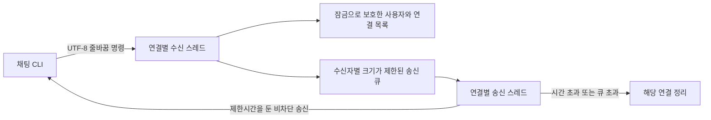
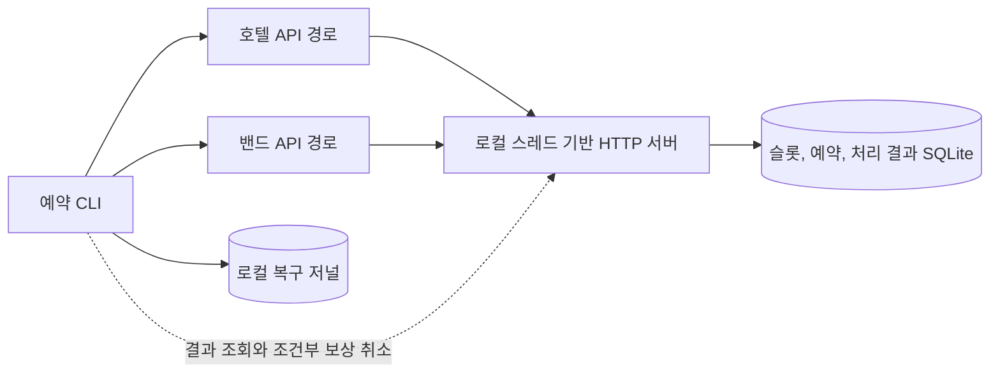

# 설계와 장애 처리

[English](ARCHITECTURE.md) | [한국어](ARCHITECTURE.ko.md) | [프로젝트 안내](../README.ko.md)

## 범위와 호환성

줄바꿈으로 메시지를 구분하는 TCP 채팅과 HTTP 기반 호텔 및 밴드 예약을 하나의 저장소에서 관리합니다. 최초 개발 기간인 2024년 9월부터 12월은 유지하고, 2026년 10월에 수행한 안정성 보강을 별도로 기록했습니다. 초기 명령과 예약 URL, 응답 형식, 수동 조작과 가장 이른 공통 슬롯을 찾는 기능을 유지하면서 실패 처리와 검증 범위를 확장했습니다.

## Talk: 자원에 한계를 둔 스레드 기반 통신

서버는 `socketserver.ThreadingTCPServer` 구조를 유지합니다. 연결별 처리 스레드를 만들기 전에 세마포어로 수용 가능 여부를 판단합니다. 스레드를 무제한으로 만든 뒤 접속을 거절하는 방식이 아닙니다. 허용한 연결에는 수신 스레드와 송신 스레드가 각각 하나씩 있습니다. 느린 수신자를 격리하기 위해 스레드 수가 늘어나며 최대 연결 수로 그 비용을 제한합니다.

공유 연결 목록과 사용자명 인덱스는 `RLock`으로 보호합니다. 등록 확인 응답을 새 연결의 FIFO 큐에 넣은 다음 사용자명을 공개합니다. 두 작업은 같은 공유 상태 잠금 아래에서 수행되므로 다른 사용자의 전체 메시지가 등록 확인보다 먼저 들어갈 수 없습니다. 큐에 넣는 잠금은 실패한 연결을 정리하기 위한 공유 상태 잠금 획득 전에 해제합니다.

수신 스레드는 줄바꿈까지 바이트를 모으고 크기를 검사한 뒤 UTF-8로 해석합니다. 한글의 여러 바이트가 나뉘어 도착하거나 여러 명령이 한 번에 도착해도 TCP 수신 횟수를 메시지 경계로 취급하지 않습니다. 빈 줄은 무시합니다. 잘못된 UTF-8이나 너무 긴 입력은 전송 가능한 경우 오류를 알린 뒤 연결을 종료합니다. 줄바꿈 없이 끝난 마지막 입력은 실행하지 않습니다.

| 제한 대상 | 기본값 | 초과 시 처리 |
| --- | ---: | --- |
| 허용 연결 수 | 128개 | 추가 연결 거절 |
| 줄바꿈을 제외한 입력 한 줄 | 8,192바이트 | 오류 안내 후 연결 종료 |
| 사용자명 | UTF-8 64바이트 | 이름 거절 후 재등록 허용 |
| 미등록 연결 | 연결 후 30초 | 등록 대기 종료 후 연결 정리 |
| 수신자별 송신 큐 | 128개 프레임 | 해당 연결 종료 |
| 프레임 하나의 송신 | 2초 | 해당 연결 종료 |

송신 스레드는 비차단 소켓과 단조 증가 시계의 제한시간을 사용합니다. 프레임의 모든 바이트를 로컬 소켓에 쓴 경우에만 송신 완료 수를 증가시킵니다. 큐에 넣은 수, 소켓에 쓴 수, 수신자가 실제로 관찰한 수는 서로 다릅니다. 프로토콜이 부여하는 메시지 식별자나 수신 확인, 재전송, 영속 대화 이력은 제공하지 않습니다. 여러 사용자가 동시에 전체 전송한 경우 모든 수신자에게 동일한 전역 순서를 보장하는 설계도 아닙니다.

서버 종료 시 연결에 종료 신호를 보내고 소켓을 종료해 수신과 송신 대기를 깨운 뒤 제한시간 안에서 처리 스레드를 기다립니다. 정상적인 `quit`은 종료 확인 응답을 제한된 시간 동안 보낼 수 있도록 합니다. 클라이언트도 콘솔 입력을 무기한 대기하는 TextIO 호출 대신 입력 상태를 확인합니다. 소켓 종료 후 수신 스레드를 기다리므로 읽기 잠금 때문에 종료가 막히는 문제를 줄였습니다. Windows 파이프와 POSIX 파일 디스크립터는 각 운영체제의 준비 상태 확인을 사용하며, Windows 대화형 콘솔은 별도의 키 입력 경로를 사용합니다.

`server.diagnostics()`와 같은 기능의 `snapshot()`은 대화 내용 없이 카운터를 제공합니다. `messages_enqueued`와 `messages_sent`에는 프로토콜 응답도 포함됩니다. 벤치마크의 실제 수신량은 시험용 메시지에 넣은 식별자를 클라이언트에서 따로 세어야 합니다.

## Hotel: 변경 요청과 처리 결과의 원자적 저장

호텔과 밴드는 **하나의 로컬 HTTP 프로세스**가 제공하는 논리적 자원입니다. 독립 서버 두 개를 운영한다는 뜻은 아니며 각 예약 요청은 별도로 커밋됩니다. 예약 테이블의 `(service, slot_id)` 기본키가 같은 슬롯의 중복 예약을 막습니다. 변경 요청은 `BEGIN IMMEDIATE`로 직렬화해 사용자별 예약 상한을 확인하고, 예약 변경과 해당 요청의 처리 결과를 같은 트랜잭션에 저장합니다.

`Idempotency-Key`는 하나의 논리적 POST 또는 DELETE 요청을 식별합니다. 서비스와 인증된 사용자 안에서 키를 구분합니다. 동일한 요청을 다시 보내면 변경을 반복하지 않고 저장된 상태 코드와 응답을 반환합니다. 같은 키로 메서드나 슬롯 또는 예상 예약 세대를 바꾸면 `409`와 `idempotency_key_conflict`를 반환합니다. 키가 없는 호출은 초기 API 동작을 유지하며 개선된 Python 클라이언트는 재시도에 같은 키를 사용합니다.

`GET /{service}/api/operation/{operation_id}`는 인증된 사용자의 과거 요청 결과와 현재 예약 세대의 비교 결과를 제공합니다. 생성 요청의 식별자로 같은 슬롯의 이전 예약과 나중에 생성한 예약을 구분합니다. 보상 DELETE에 포함하는 `Expected-Reservation-Operation-Id`를 쓰기 트랜잭션 안에서 검사합니다. 세대가 다르면 새 예약을 지우는 대신 `stale_reservation`으로 거절합니다.

처리 결과는 자동 만료시키지 않습니다. 재시도와 복구의 근거이므로 일반적인 출력 로그처럼 임의로 삭제하는 자료가 아닙니다. 초기 예약 DB에는 필요한 메타데이터 열을 추가하고 보유 예약을 삭제하지 않습니다. 로컬 설치 환경을 백업할 때는 예약 데이터와 서버 처리 결과, 미해결 작업이 있는 클라이언트 저널을 함께 보존해야 합니다.

DB 사용 중 또는 잠금 오류는 `503`으로 반환하며, 업무 규칙에 따른 오류는 초기 상태 코드 체계를 유지합니다. HTTP 클라이언트는 유한 횟수만 재시도하고 같은 작업 키를 재사용합니다. `max_elapsed`는 다음 재시도와 Requests 요청에 배분할 남은 시간을 제한하는 예산입니다. DNS 조회나 반복되는 소켓 활동, 별도 확인 요청과 전체 워크플로까지 포함하는 절대 종료 시각은 아닙니다.

## 예약 CLI: 복구 가능한 보상 처리

자동 예약은 HTTP 변경 요청보다 먼저 SQLite `RecoveryJournal`에 의도와 작업 식별자를 커밋합니다. 대화형 CLI는 파일 저널을 열고 사용하는 동안 프로세스 간 잠금을 유지합니다. 프로세스가 종료되면 운영체제가 잠금을 해제합니다. HTTP 응답을 기다리는 동안 SQLite 쓰기 트랜잭션을 계속 열어 두는 구조는 아닙니다.

`reserve_best_match(clients)`를 직접 호출하면 해당 호출에 한정된 메모리 저널을 사용합니다. 프로세스 종료 후에는 복구할 수 없습니다. 재시작 복구가 필요하면 `RecoveryJournal(path)`를 명시적으로 전달하고 이후 같은 파일로 복구해야 합니다. CLI의 기본 저널은 `Hotel/data/booking-journal.db`이고 `BOOKING_JOURNAL_PATH`로 바꿀 수 있습니다.

| 상태 | 복구 판단 |
| --- | --- |
| `hotel_pending` | 초기 키로 호텔 요청 결과를 조회하거나 같은 요청 재전송 |
| `hotel_reserved` | 밴드 요청 의도가 기록되기 전에 중단된 호텔 예약을 보상 취소 |
| `band_pending` | 호텔의 현재 예약 세대를 확인하고 기록된 밴드 요청 결과 확인 |
| `pair_check` | 양쪽의 현재 예약 세대를 확인하고 불확실하면 보류 |
| `compensating` | 생성 식별자를 조건으로 호텔 보상 취소 재확인 |
| `pair_compensating` | 해당 작업이 생성한 양쪽 예약의 조건부 취소 확인 |
| `matched` / `aborted` | 해당 작업의 해결 결과를 기록한 종료 상태 |

처리 기록이 없거나 형식이 잘못되었다는 이유만으로 이전 요청을 실패로 확정하지 않습니다. 알 수 없는 결과는 보존하고 초기 작업 식별자로 다시 확인합니다. 복구된 예약 쌍을 성공으로 알리기 전에는 호텔과 밴드의 현재 예약 세대를 각각 확인합니다. 해당 예약이 다른 예약으로 교체되었다면 조건부 취소가 새 예약을 보존합니다. 보상 성공도 확인할 수 없다면 미해결 상태를 유지하고 같은 사용자 범위의 새 자동 예약을 막습니다.

자동 매칭은 별개의 수동 예약을 보존합니다. 불필요한 예약을 정리하는 동작은 사용자가 메뉴 7을 선택했을 때 수행합니다. 수동 예약과 취소의 초기 동작도 유지하며, 이를 두 서비스의 저널 기반 자동 예약으로 임의 변경하지 않았습니다.

저널에는 상태 전이, 작업 식별자, 해시로 구분한 사용자 범위와 예외 클래스 이름을 기록합니다. 평문 Bearer 토큰이나 전체 예외 문구는 저장하지 않습니다. 런타임 DB와 저널은 개인 실행 자료이므로 공개 소스 압축 파일에서 제외합니다.

## 일관성이 보장되는 범위

설계의 핵심은 복구 가능한 보상 처리입니다. 두 서비스의 분산 원자적 트랜잭션이나 전체 요청의 정확히 한 번 실행을 보장하는 시스템은 아닙니다. 한 서비스가 계속 응답하지 않으면 복구는 미해결 상태로 남습니다. 호텔과 밴드는 각각 조회하므로 하나의 원자적 스냅샷이 아닙니다. 두 확인이 성공한 뒤 외부 사용자가 예약을 바꿀 수도 있습니다. 저널의 종료 상태는 당시의 판단을 기록하며 이후 사용자 조작을 계속 감시하지 않습니다.

프로세스 잠금의 범위는 한 호스트에서 같은 저널을 쓰는 CLI입니다. 다른 저널이나 원격 사용자, 여러 호스트를 잠그는 기능은 아닙니다. 장기 운영에는 처리 기록의 보존 정책과 디스크 용량 관리가 추가로 필요합니다. 데모 인증과 표준 라이브러리 HTTP 서버, SQLite 구성은 재현 가능한 로컬 실행을 대상으로 합니다.

## 검증 자료와 재현

실제 TCP와 HTTP, 동시 예약, 응답 유실, 보상 취소, 프로세스 종료와 재시작을 포함한 **85개 검사를 4개 환경에서 모두 통과**했습니다. 총 340회 실행에서 실패와 오류, 생략은 0건이며, 초기 5개 검사도 유지했습니다.

검증 환경은 **Windows Python 3.10.22 / 3.12.7, WSL Ubuntu Python 3.10.22 / 3.12.3**입니다. 각각 분리한 가상환경에서 잠금 파일로 의존성을 설치했습니다. Linux는 별도 소스 복사본을 사용했으며, 4개 환경의 소스 해시가 일치합니다. WSL은 같은 물리 컴퓨터를 사용합니다. GitHub Actions 성공을 주장하는 결과는 아닙니다.

검증에는 실제 로컬 TCP와 HTTP 통신, 임시 DB, 응답 유실, 동시 요청, 프로세스 중단과 실제 CLI subprocess를 사용합니다. `scripts/verify.py`는 실행 환경과 테스트별 결과, 줄바꿈을 정규화한 소스 해시를 JSON으로 기록합니다. Windows의 CRLF와 Linux의 LF 차이를 코드 변경으로 잘못 해석하지 않도록 해시 계산 전에 줄바꿈을 통일합니다.

느린 연결 1개와 정상 수신자 3개를 둔 같은 실험을 각 버전에서 3회 수행했습니다. 계획한 수신은 매회 900건이며 **초기 3건에서 개선 후 900건**으로 늘었습니다. 초기에는 300회 방송 중 48회만 시도하고 47회를 소켓에 전송했으므로 미완료 관찰을 메시지 유실률로 해석할 수 없습니다. 정상 60개 연결의 회차별 p95 중앙값은 **1.6338ms에서 3.2020ms**로 증가했습니다. 자원 사용 수치는 서버와 측정 클라이언트를 함께 포함합니다.

초기 버전과 개선 버전은 같은 `scripts/benchmark.py`로 측정합니다. 정상 조건에서는 모든 수신자가 받은 것을 확인한 뒤 다음 측정 메시지를 보냅니다. 느린 수신자 조건은 소켓 버퍼를 제한하고 정상 수신자에게 도착한 메시지를 직접 집계합니다. 이는 통제된 루프백 결과이며 일반적인 최대 처리량을 뜻하지 않습니다. [공개 검증 요약](reports/verification-summary.json)과 [전체 비교](reports/comparison.json)에서 조건을 확인할 수 있습니다.
