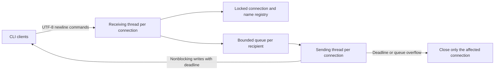
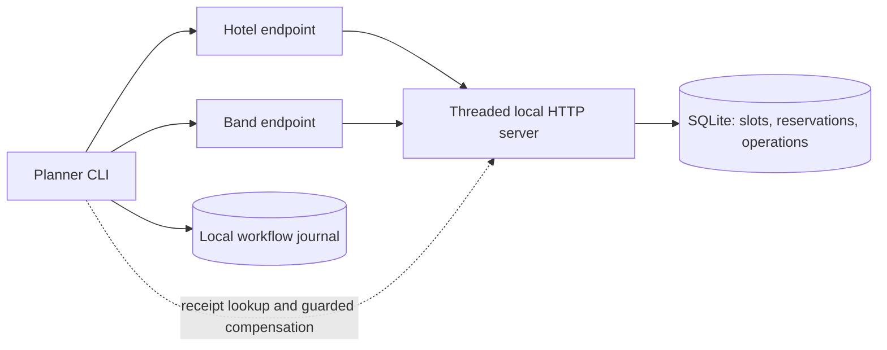

# Architecture and Failure Handling

[English](ARCHITECTURE.md) | [한국어](ARCHITECTURE.ko.md) | [Project README](../README.md)

## Scope and compatibility

The repository contains two independent applications: a newline-delimited TCP chat and an HTTP hotel/band booking planner. The September to December 2024 development period remains unchanged. October 2026 maintenance strengthens failure handling without replacing the initial commands, reservation URLs, response bodies, manual actions, or automatic earliest-slot matching.

## Talk: bounded threaded messaging

The server retains `socketserver.ThreadingTCPServer`. A capacity semaphore is acquired before starting a connection handler, so a connection limit does not merely reject clients after creating unlimited receiving threads. Each admitted connection has one receiving thread and one sending thread. This increases the bounded thread count in exchange for isolating blocked writes.

An `RLock` protects connection membership and the username index. A registration confirmation is placed into the new peer's FIFO queue while holding this registry lock, and the name becomes visible only afterward. A concurrent broadcast cannot enter that peer's queue ahead of the confirmation. The queue-enqueue lock is released before failed-peer cleanup acquires the registry lock, avoiding reverse lock acquisition.

A receiver accumulates bytes until newline, validates the byte limit, then decodes strict UTF-8. Fragmented multibyte characters and multiple frames in one TCP read work without treating TCP reads as message boundaries. Blank lines are ignored. Invalid UTF-8 or oversized frames receive an error when the connection is writable and are then closed. An incomplete final line is not executed.

| Resource | Default bound | Failure policy |
| --- | ---: | --- |
| Admitted connections | 128 | Reject the extra connection |
| Input frame excluding newline | 8,192 bytes | Reject and disconnect |
| Username | 64 UTF-8 bytes | Reject the name; permit another registration attempt |
| Unregistered connection | 30 seconds from connection | End the registration wait and disconnect |
| Outgoing queue | 128 frames per peer | Disconnect the peer whose queue overflows |
| Writing one outgoing frame | 2 seconds | Close that peer when the deadline is exceeded |

The outgoing writer uses nonblocking `send` and readiness polling with a monotonic deadline. It counts a frame as sent only after every byte has been accepted by the local socket. Enqueued frames, completed writes, and actual client observations are different quantities. The implementation does not provide message identifiers on the wire, receiver acknowledgements, replay, durable history, or a total order shared by all recipients of concurrent broadcasts.

Shutdown signals handlers, shuts down their sockets to wake reads and writes, and waits for tracked requests within a configured shutdown window. A normal quit or protocol rejection drains its response and sends FIN with `SHUT_WR`, then discards unread input for at most 0.1 seconds within the existing `send_timeout + 0.1` writer-drain budget. This avoids a Windows reset discarding the response when trailing input remains. Discarded input is not executed, and continuous input cannot extend the deadline. Failed writers and forced shutdown still abort the affected connection. The client polls console input rather than leaving a blocking TextIO read alive during process shutdown. Its network receiver is woken by socket shutdown before thread joining. Windows pipes and POSIX file descriptors use their respective readiness mechanisms; the interactive Windows console has a separate key polling path.

`server.diagnostics()` and its `snapshot()` alias expose counts without chat bodies. `messages_enqueued` and `messages_sent` include protocol responses. `send_failures` is updated after the failed peer is closed and removed from the registry. A benchmark must identify its own payloads and count received message IDs independently.

## Hotel: transactional request receipts

Hotel and Band are logical resources in **one local HTTP process**, not independently deployed services. Their API operations remain separately committed. SQLite's `(service, slot_id)` reservation primary key prevents a duplicate reservation. `BEGIN IMMEDIATE` serializes competing mutations, checks the per-user limit, and stores the mutation result with its operation receipt in the same transaction.

An `Idempotency-Key` identifies one logical POST or DELETE. Its scope is the service and authenticated identity. A matching replay returns the recorded status and body without applying the mutation again. Reuse with a different method, slot, or expected reservation generation returns `409` with `idempotency_key_conflict`. Calls without a key retain the original API behavior; the updated Python client supplies a stable key for its retries.

`GET /{service}/api/operation/{operation_id}` authenticates the caller and returns the historical outcome plus a comparison with the current reservation generation. A reservation creation identifier distinguishes a slot's old reservation from a later booking of the same slot. `Expected-Reservation-Operation-Id` on compensation DELETE checks that identifier inside the write transaction. A mismatch returns `stale_reservation` rather than removing the replacement reservation.

Receipt rows have no automatic expiry. They are part of the retry and recovery contract, not disposable logging. Initial reservation databases are upgraded by adding the required metadata column without dropping held slots. Unresolved journal entries and server receipts should be backed up together with the reservation data when maintaining a local installation.

Database busy/locked errors return `503`, while semantic errors retain their initial status mapping. The HTTP client reuses an operation key across finite retries and distinguishes conflicts from an uncertain write. Its `max_elapsed` is a retry budget and is used to bound the remaining timeout passed to Requests. DNS resolution, repeated socket activity, separate follow-up requests, and the whole workflow are not covered by a hard absolute wall-clock guarantee.

The planner's `_receipt_outcome` confirms an uncertain mutation with read-only receipt GETs, using an attempt limit of `max(2, client.retries)`. All attempts within that lookup share one existing `max_elapsed` budget; an exhausted budget can stop them earlier. Retrying this confirmation adds no mutation POST and does not alter mutation retry limits. Missing or malformed proof still leaves the outcome uncertain, and current Hotel/Band generation checks remain required before declaring a matched pair.

## Planner: recoverable compensation

Before an automatic mutation, the planner commits its intent and operation identifiers to a SQLite `RecoveryJournal`. The interactive CLI opens a file-backed journal and holds a cross-process lock while using it. The lock is released when the process exits; it is not a long-running SQLite write transaction around HTTP calls.

The default direct library call `reserve_best_match(clients)` creates an in-memory journal. It is isolated for that call and cannot recover after process exit. Callers needing restart recovery must explicitly pass `RecoveryJournal(path)` and use the same file for later recovery. The CLI defaults to `Hotel/data/booking-journal.db`; `BOOKING_JOURNAL_PATH` overrides it.

| State | Recovery decision |
| --- | --- |
| `hotel_pending` | Resolve or replay the Hotel operation using its original key |
| `hotel_reserved` | Compensate an interrupted attempt that never recorded Band intent |
| `band_pending` | Check Hotel's current generation and resolve Band's recorded operation |
| `pair_check` | Confirm both current reservation generations, or retain uncertainty |
| `compensating` | Retry Hotel compensation guarded by its creation identifier |
| `pair_compensating` | Resolve guarded compensation for both workflow-owned reservations |
| `matched` / `aborted` | Terminal record of this workflow's resolution |

A missing or malformed receipt is not proof that an earlier write failed. The planner retains unknown outcomes and retries with the original operation identifiers. It checks current Hotel and Band generations before reporting a recovered pair as matched. If an owned booking was replaced, guarded compensation leaves the newer booking untouched. Failure to confirm compensation keeps the workflow unresolved and blocks another automatic attempt for that scope.

Automatic matching preserves unrelated manual bookings. Removing unnecessary reservations remains the explicit action selected through menu 7. Manual reserve and cancel actions preserve their original behavior and are not converted into the journaled two-service workflow.

The journal records state transitions, operation identifiers, hashed account scope, and exception class names. It does not store plaintext bearer tokens or full exception messages. Runtime DBs and journal files remain private artifacts and are excluded from the public source package.

## Consistency boundaries

The planner implements recoverable compensation, not a distributed atomic transaction or an exactly-once end-to-end service. A service can remain unreachable, so recovery may remain pending. Checking Hotel and Band uses separate reads, not one atomic snapshot. Both checks may succeed before an external actor changes a booking. A terminal journal state records the decision at that time and does not continually monitor later user actions.

The process lock coordinates planners sharing one journal on one host. It does not lock remote users, different journal files, or multiple machines. Receipt retention and local disk capacity require an explicit lifecycle policy before long-term production use. The demo authentication, standard-library HTTP server, and SQLite layout target reproducible local execution.

## Evidence and reproduction

**89 tests passed on Windows Python 3.10.21 and 3.12.7** for the repaired source, with no failures, errors or skips in 178 executions. Both runs record the same current source hashes and include the initial five tests. The [CI repair verification](reports/ci-repair-verification.json) links both complete local records and the targeted delayed-reader and continuous-flood evidence. For automated cross-platform runs, see [GitHub Actions](https://github.com/Dongmyung378/Distributed-System/actions/workflows/ci.yml).

The retained earlier snapshot passed **85 tests in each of four environments**, or 340 executions, with no failures, errors or skips. Those environments were **Windows Python 3.10.22 / 3.12.7 and WSL Ubuntu Python 3.10.22 / 3.12.3**, using separate virtual environments installed from the dependency lock. Linux used a separate source copy; normalized source hashes match within those four historical runs. WSL shares the same physical host. These verification and performance records retain their original source snapshot.

The suite uses real loopback TCP and HTTP sockets, temporary databases, controlled lost responses, concurrency, process termination, and real CLI subprocesses. `scripts/verify.py` writes the environment, per-test outcome, and normalized source hashes to JSON. Normalizing CRLF to LF avoids reporting Windows checkout line endings as a different source version.

In the retained benchmark snapshot, one stalled connection and three healthy receivers were used in three identical trials per version: **3 of 900 planned delivery observations initially, versus 900 of 900 after strengthening in every trial**. The initial writer attempted only 48 of 300 broadcasts and submitted 47, so incomplete observations are not a message-loss rate. Under 60 healthy connections the median trial-level p95 rose from **1.6338ms to 3.2020ms**. Resource measurements include the server and client harness together.

The same `scripts/benchmark.py` harness measures both source versions. Its healthy trials wait for all recipients before the next measured broadcast. The stalled-peer fixture constrains socket buffers and measures actual healthy-client receipts. These are controlled loopback observations, not broad throughput claims. See the [public verification summary](reports/verification-summary.json) and [complete comparison](reports/comparison.json).
